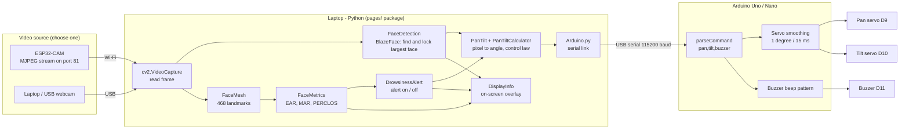
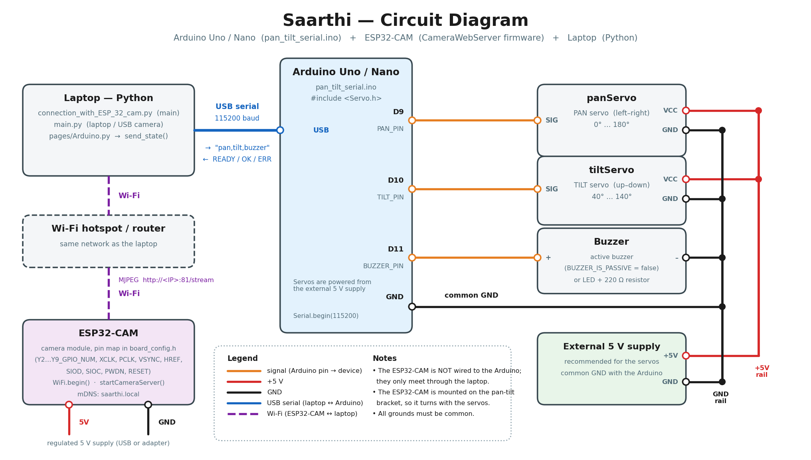

<div align="center">

# Saarthi — Real-Time Driver Drowsiness Detection with an Auto-Tracking Camera

[](https://www.python.org/)
[](https://opencv.org/)
[](https://developers.google.com/mediapipe)
[](https://numpy.org/)
[](https://protobuf.dev/)
[](https://pyserial.readthedocs.io/)

[](https://opencv.org/)
[](https://developers.google.com/mediapipe/solutions/vision/face_landmarker)
[](#description)
[](#model_loaderpy--modelloader)

[](#installation)
[](#hardware-and-circuit)
[](#license)

</div>

---

## Description

**Saarthi** (Hindi for *charioteer* / *driver*) is a real-time driver drowsiness detection and warning system built as a 5th-semester **Electronic Product Development (EPD)** project.

A camera watches the driver's face. For every video frame the software measures how open the **eyes** and **mouth** are, keeps a rolling record of how long the eyes stay closed, and decides whether the driver is becoming drowsy. When it is, a **buzzer** is sounded. At the same time, a **two-servo pan-tilt mount** physically turns the camera so that it always follows the driver's face and keeps it in the middle of the picture.

The system is split into two cooperating parts:

| Part | Runs on | Job |
|------|---------|-----|
| **Vision and decision software** (Python) | Laptop | Detects the face, computes EAR / MAR / PERCLOS, decides the alert, computes pan-tilt angles |
| **Actuator controller** (Arduino sketch) | Arduino Uno / Nano | Moves the two servos smoothly and beeps the buzzer when told to |

Video can come from either an **ESP32-CAM** (wireless, over Wi-Fi) or a normal **laptop / USB webcam**.

> **Which file do I run?**
> The **main file of this project is `connection_with_ESP_32_cam.py`** — it reads the video stream from the ESP32-CAM.
> `main.py` is the same system for the **laptop's built-in camera or any USB camera**. Both files use the same modules in `pages/`.

<!-- ======================= IMAGE 1 OF 3: FINAL PRODUCT =======================
     Save your photo as docs/images/final-product.png (or change the path below). -->
<p align="center">
  
  <br>
  <em>Figure 1 — The finished Saarthi unit (camera on the pan-tilt mount with buzzer). <strong>[Add image]</strong></em>
</p>

---

## Quick Start — Run It from the Terminal

Run these commands from a terminal (PowerShell, CMD, Terminal or bash) to set up a Python **virtual environment**, install the packages and start the system. Python 3.11 is recommended.

**1. Get the project and open its folder**

```bash
git clone https://github.com/abhinavkumar346/Driver-Drowsiness-Detection-System.git
cd Driver-Drowsiness-Detection-System
```

**2. Create a virtual environment**

```bash
# Windows
python -m venv venv

# Linux / macOS
python3 -m venv venv
```

**3. Activate it** (the prompt will start with `(venv)`)

```powershell
# Windows - PowerShell
venv\Scripts\Activate.ps1

# Windows - CMD
venv\Scripts\activate.bat
```

```bash
# Linux / macOS
source venv/bin/activate
```

> If PowerShell says *"running scripts is disabled"*, run `Set-ExecutionPolicy -Scope Process -ExecutionPolicy Bypass` once in that window, then activate again.

**4. Install the dependencies**

```bash
python -m pip install --upgrade pip
pip install -r requirements.txt
```

**5. Run the project** (with the virtual environment still active)

```bash
# MAIN version - ESP32-CAM stream (edit the URL line in the file to your board's IP first)
python connection_with_ESP_32_cam.py

# Laptop's built-in camera or a USB camera
python main.py
```

Useful options (they work with both scripts; `--camera` is for `main.py` only):

```bash
python connection_with_ESP_32_cam.py --port COM4        # choose the Arduino port (Linux: /dev/ttyUSB0)
python connection_with_ESP_32_cam.py --no-hardware      # vision only, no Arduino connected
python main.py --camera 1                               # use the second camera
```

Press `q` or `Esc` in the video window to quit.

**6. Leave the virtual environment when you are done**

```bash
deactivate
```

> Next time, you only need steps **3** and **5** (activate, then run). Full explanations are in the [User Manual](#user-manual).

---

## Context

This README explains the complete project in the following order:

1. [Quick Start](#quick-start--run-it-from-the-terminal) — the terminal commands to create a virtual environment, install and run.
2. [Key Features](#key-features) — what the system can do.
3. [System Architecture](#system-architecture) — how the camera, laptop, Arduino and buzzer fit together.
4. [Hardware and Circuit](#hardware-and-circuit) — components, pin connections and the circuit diagram.
5. [Repository Structure](#repository-structure) — what each file and folder is for.
6. [The Two Entry Points](#the-two-entry-points) — `connection_with_ESP_32_cam.py` (main, ESP32-CAM) and `main.py` (laptop / USB camera).
7. [Module Reference](#module-reference) — the use of every module in `pages/`, the Arduino sketch and the tests.
8. [Calculations and Formulas](#calculations-and-formulas) — every calculation with its formula, code and a worked example:
   [face offset](#face-centre-and-offset), [pixel-to-angle](#pixel-to-angle-conversion), [pan-tilt control](#pan-tilt-control-law),
   [EAR](#eye-aspect-ratio-ear), [MAR](#mouth-aspect-ratio-mar), [PERCLOS](#perclos), [alert logic](#drowsiness-alert-logic) and [Arduino-side motion](#arduino-side-motion-and-buzzer-timing).
9. [Tunable Parameters](#tunable-parameters) — every setting in one table.
10. [Python ↔ Arduino Serial Protocol](#python--arduino-serial-protocol) — the message format.
11. [ESP32-CAM Firmware](#esp32-cam-firmware) — the camera-side code.
12. [Installation](#installation) — how to set everything up.
13. [User Manual](#user-manual) — how it works and how to use it, step by step.
14. [Testing](#testing) — running the automated tests.
15. [Troubleshooting](#troubleshooting) and [Limitations](#limitations-and-notes).
16. [Team](#team), [Acknowledgements](#acknowledgements) and [License](#license).

---

## Key Features

- **Real-time drowsiness detection** from three signals: eye closure (**EAR**), yawning (**MAR**) and the rolling percentage of eye closure (**PERCLOS**).
- **Two ways to trigger the alert**: sustained eye closure for 2 seconds, *or* PERCLOS above 30 % in the last 60 seconds.
- **Auto-tracking pan-tilt camera** — a proportional controller with a dead-band and a step limit keeps the driver's face centred without jitter or overshoot.
- **Two camera sources** — ESP32-CAM over Wi-Fi (main) or a laptop / USB camera.
- **Hardware buzzer alert** driven by an Arduino with a safety time-out (a lost USB link can never leave the buzzer stuck on).
- **Self-healing USB link** — if the Arduino is unplugged, the video keeps running and the program reconnects automatically.
- **Runs without hardware** — the `--no-hardware` flag lets you test the vision software with only a camera.
- **Automated tests** that need neither a camera nor an Arduino.

---

## System Architecture



**What happens on every frame** (identical in both entry points):

| Step | What happens | Module |
|------|--------------|--------|
| 1 | Grab a frame and convert BGR → RGB | `cv2` |
| 2 | Detect faces, lock onto the **largest** one, compute its offset from the frame centre (`dx`, `dy`) | `FaceDetection` |
| 3 | Run Face Mesh, compute **EAR**, **MAR**, `eye_closed`, `yawning` | `FaceMetrics` |
| 4 | Update the 60-second **PERCLOS** window | `FaceMetrics` |
| 5 | Decide whether the **drowsiness alert** is on | `DrowsinessAlert` |
| 6 | Compute new pan / tilt angles and send `pan,tilt,buzzer` to the Arduino (max 10 times / second) | `PanTilt` |
| 7 | Draw the overlay and show the window; `q` or `Esc` quits | `DisplayInfo` |

---

## Hardware and Circuit

### Components

| Component | Purpose |
|-----------|---------|
| ESP32-CAM (AI-Thinker style, with PSRAM) | Wireless camera that streams MJPEG video over Wi-Fi |
| Arduino Uno or Nano | Receives commands over USB and drives the servos and the buzzer |
| 2 × hobby servo (e.g. SG90 / MG90S) | **Pan** (left-right) and **tilt** (up-down) axes of the camera mount |
| Buzzer (active by default) | Audible drowsiness warning |
| Laptop | Runs the Python software |
| Wi-Fi access point or phone hotspot | Network between the ESP32-CAM and the laptop |
| External 5 V supply *(recommended)* | Powers the servos so they do not brown-out the Arduino |

### Pin connections (from `pan_tilt_serial.ino`)

| Arduino pin | Connected to | Notes |
|-------------|--------------|-------|
| **D9** | Pan servo signal wire | Range 0°–180° |
| **D10** | Tilt servo signal wire | Range limited to 40°–140° in firmware |
| **D11** | Buzzer **+** (or LED + 220 Ω resistor) | Other leg to GND |
| **GND** | Servo GND, buzzer GND, external supply GND | **All grounds must be common** |
| **USB** | Laptop | Serial at 115200 baud and power for the Arduino |

> If your buzzer only *clicks* instead of beeping, it is a **passive** buzzer: set `BUZZER_IS_PASSIVE = true` in the sketch.

<!-- ======================= IMAGE 2 OF 3: CIRCUIT DIAGRAM =======================
     Save your diagram as docs/images/circuit-diagram.png (or change the path below). -->
<p align="center">
  
  <br>
  <em>Figure 2 — Circuit diagram: Arduino, two servos, buzzer and ESP32-CAM. <strong>[Add image]</strong></em>
</p>

---

## Repository Structure

```text
EPD_project_5th_sem/
├── connection_with_ESP_32_cam.py   # MAIN entry point - reads the ESP32-CAM stream
├── main.py                         # Entry point for the laptop camera / any USB camera
├── requirements.txt                # Python dependencies
│
├── pages/                          # The reusable modules (a Python package)
│   ├── __init__.py                 # Exposes the classes used by the entry points
│   ├── model_loader.py             # Loads / releases the MediaPipe models
│   ├── face_detection.py           # Finds faces, locks the largest, computes dx / dy
│   ├── processing_info.py          # FaceMetrics (EAR, MAR, PERCLOS) + PanTiltCalculator
│   ├── alert.py                    # Decides when the drowsiness alert is on
│   ├── pantilt.py                  # Timing, USB connection handling, sends commands
│   ├── Arduino.py                  # Low-level serial communication with the Arduino
│   └── display_info.py             # Draws the overlay on the video window
│
├── pan_tilt_serial/
│   └── pan_tilt_serial.ino         # Arduino sketch: servos + buzzer over USB serial
│
├── tests/
│   ├── test_logic.py               # Unit tests - no camera / Arduino needed
│   └── test_esp32_cam connection.py# Quick check that the ESP32-CAM stream opens
│
├── esp32_cam_firmware/             # (add this folder) ESP32-CAM sketch, e.g. main.cpp
└── docs/images/                    # (add this folder) the three README images
```

---

## The Two Entry Points

Both scripts run the **same pipeline**; only the **video source** (and a few startup details) differ.

| | `connection_with_ESP_32_cam.py` — **MAIN** | `main.py` |
|---|---|---|
| **Video source** | ESP32-CAM Wi-Fi stream: `http://<ESP32-IP>:81/stream` | Laptop built-in camera or any USB camera |
| **How the source is chosen** | The `URL` constant near the top of the file | `--camera N` (camera index, default `0`) |
| **Camera opening** | `cv2.VideoCapture(URL)` | `open_camera()` — uses DirectShow on Windows, falls back to the default backend, sets a 1-frame buffer for fresh frames |
| **Frame size** | 320 × 240 (QVGA, set in the ESP32 firmware) | Whatever the camera provides |
| **Command-line flags** | `--port`, `--no-hardware` | `--camera`, `--port`, `--no-hardware` |
| **Program structure** | Runs at module level | `main()` function with `if __name__ == "__main__":` |
| **"Face found" means** | The face *detector* found a face | The face *mesh* produced landmarks |
| **Use it for** | The final product (wireless camera) | Development, testing, or as a fallback when Wi-Fi is not available |

### `connection_with_ESP_32_cam.py` (main file)

1. Parses `--port` and `--no-hardware`.
2. Loads the MediaPipe models and creates `FaceDetection`, `FaceMetrics`, `DrowsinessAlert`, `DisplayInfo`.
3. Opens the stream with `cv2.VideoCapture(URL)` where `URL = "http://172.20.10.4:81/stream"`.
4. Connects to the Arduino through `PanTilt(...)`.
5. Loops: read frame → detect → measure → alert → move servos → draw → show.
6. If **30 consecutive** frames fail to arrive (`MAX_FAILED_READS`), it prints a message and exits.
7. In the `finally` block it always re-centres the servos, switches the buzzer off, releases the serial port and the camera, and closes the models.

> **Change the IP address** to match your ESP32-CAM. It is printed in the Arduino Serial Monitor when the board connects (`Fallback camera IP: http://...`). The stream URL is that address plus `:81/stream`.

### `main.py` (laptop / USB camera)

Same loop, wrapped in `main()`. Extra behaviour:

- `--camera 0` selects the built-in camera; use `--camera 1`, `--camera 2` … for USB cameras.
- `open_camera(index)` tries **DirectShow first on Windows** (faster and more reliable) and then the default backend, and sets `CAP_PROP_BUFFERSIZE = 1` so the tracker always works on the newest frame instead of a queue of old ones.
- If no camera can be opened it exits with a helpful message ("close other apps that use it, or try `--camera 1`").

---
## Module Reference

Everything in `pages/` is imported through `pages/__init__.py`, so the entry points can simply write `from pages import ModelLoader, FaceDetection, ...`.

### `model_loader.py` — `ModelLoader`

**Use:** creates the two MediaPipe models once, shares them with the rest of the program, and closes them cleanly at the end.

| Method | What it does |
|--------|--------------|
| `load_models()` | Creates the **face detector** and the **face mesh** (only if they do not exist yet) |
| `get_face_detector(...)`, `get_face_mesh(...)` | Same models with custom settings; create on first use and return them |
| `release_models()` | Closes both models and frees their memory (called in the `finally` block) |

Settings used by `load_models()`:

| Model | Setting | Value | Meaning |
|-------|---------|-------|---------|
| Face detector (BlazeFace) | `model_selection` | `0` | Short-range model (faces within about 2 m — suits a driver) |
| Face detector | `min_detection_confidence` | `0.5` | Ignore detections below 50 % confidence |
| Face mesh | `static_image_mode` | `False` | Video mode: track landmarks between frames (faster, smoother) |
| Face mesh | `max_num_faces` | `1` | Only the driver |
| Face mesh | `refine_landmarks` | `False` | Standard 468 landmarks (no iris points) |
| Face mesh | `min_detection_confidence` / `min_tracking_confidence` | `0.5` / `0.5` | Confidence limits |

<sub>`pages/model_loader.py` — lines 8–22</sub>

```python
    def load_models(self):
        if self.face_detector is None:
            self.face_detector = mp.solutions.face_detection.FaceDetection(
                model_selection=0,
                min_detection_confidence=0.5,
            )

        if self.face_mesh is None:
            self.face_mesh = mp.solutions.face_mesh.FaceMesh(
                static_image_mode=False,
                max_num_faces=1,
                refine_landmarks=False,
                min_detection_confidence=0.5,
                min_tracking_confidence=0.5,
            )
```

### `face_detection.py` — `FaceDetection`

**Use:** finds faces, picks the one to follow, and says how far it is from the middle of the picture.

| Method | Returns |
|--------|---------|
| `detect_faces(frame_rgb)` | List of boxes `(x, y, w, h)` in **pixels** (MediaPipe gives relative 0–1 values, converted and clipped to the frame) |
| `get_locked_face(boxes)` | The **largest** box as `(x, y, w, h, cx, cy)`, or `None` — this is the "locked" driver |
| `get_offset(face, frame_w, frame_h)` | `(dx, dy)` = face centre minus frame centre in pixels, or `(None, None)` when there is no face |

### `processing_info.py` — `FaceMetrics` and `PanTiltCalculator`

**Use:** all the numeric work of the project lives here.

| Class | Responsibility |
|-------|----------------|
| `FaceMetrics` | Converts Face Mesh landmarks into **EAR**, **MAR**, the `eye_closed` / `yawning` flags and the rolling **PERCLOS** value |
| `PanTiltCalculator` | Converts the face offset (pixels) into **pan / tilt angles** (degrees) with the control law |

`FaceMetrics.process(results, frame_w, frame_h)` returns `(avg_ear, mar, eye_closed, yawning)`; when no face is found it returns `(None, None, False, False)`. `crop_face()` is an optional helper that is not used by the main code. All formulas are explained in [Calculations and Formulas](#calculations-and-formulas).

### `alert.py` — `DrowsinessAlert`

**Use:** answers one question every frame — *"should the drowsiness alert be on right now?"* The Arduino does the beeping; this class only decides. Rules and formulas: [Drowsiness Alert Logic](#drowsiness-alert-logic).

### `pantilt.py` — `PanTilt`

**Use:** the bridge between the vision code and the hardware. It decides **when** to send, handles the USB connection, and owns a `PanTiltCalculator`.

| Feature | Behaviour |
|---------|-----------|
| Rate limit | Recalculates and sends at most every `SEND_INTERVAL = 0.1 s` (10 times / second) |
| Send only on change | Sends when `(pan, tilt, buzzer)` changed, plus a **heartbeat** at least every `HEARTBEAT = 1.0 s` so the Arduino's 5-second time-out never fires |
| Auto-reconnect | If the Arduino disappears, the video keeps running and a reconnect is tried every `RECONNECT_INTERVAL = 5 s` |
| Handshake | `connect()` sends the current angles and expects the reply `OK`; otherwise it reports that the sketch is missing or at the wrong baud rate |
| No face | The mount **holds its position** |
| `--no-hardware` | Angles are still calculated and displayed, nothing is sent |
| `close()` | Re-centres to `90, 90`, switches the buzzer off and closes the port |

<sub>`pages/pantilt.py` — lines 96–136</sub>

```python
    def update(self, dx, dy, frame_w, frame_h, alert):
        """
        dx, dy   : face center minus frame center in pixels (None when no face)
        frame_w/h: frame size in pixels
        alert    : True while the drowsiness alert is active
        Call it every frame; it only does real work every SEND_INTERVAL seconds.
        """
        now = time.monotonic()

        # --- 1. Slow down to the update rate (also keeps the correction steps small) ---
        if now - self.last_update_time < self.SEND_INTERVAL:
            return
        self.last_update_time = now

        # --- 2. Work out the new angles (the mount holds still if there is no face) ---
        pan, tilt = self.calculator.update(dx, dy, frame_w, frame_h)

        if not self.use_hardware:
            return

        # --- 3. Lost the Arduino? Try again now and then, without freezing the video ---
        if not self.connected:
            if now - self.last_connect_try >= self.RECONNECT_INTERVAL:
                self.connect()
            return

        # --- 4. Send when something changed (and every second as a keep-alive) ---
        state = (pan, tilt, 1 if alert else 0)
        changed = state != self.last_sent
        heartbeat_due = now - self.last_send_time >= self.HEARTBEAT
        if not (changed or heartbeat_due):
            return

        try:
            send_state(self.port, *state)
            self.last_sent = state
            self.last_send_time = now
        except CONNECTION_ERRORS as err:
            print(f"[PanTilt] Lost the Arduino, will keep retrying: {err}")
            self.connected = False
            self.last_connect_try = now
```

### `Arduino.py` — serial communication

**Use:** low-level USB serial functions (uses *pyserial*). It can also be run on its own as a quick hardware test:
`python pages/Arduino.py COM4`

| Function | Purpose |
|----------|---------|
| `find_ports()` / `find_arduino_port()` | List serial ports / pick the first one that looks like an Arduino (USB vendor IDs of Arduino, CH340, FTDI, CP210x) |
| `_get_port()` | Opens a port **once**, waits up to 4 s for the sketch's `READY` line, then reuses the connection (opening a port resets the Arduino, so it must not be reopened for every message) |
| `arduinoconnect(port, msg, ...)` | Sends one text line; can wait for the reply |
| `send_state(port, pan, tilt, buzzer)` | Rounds and clamps the angles, builds `"pan,tilt,buzzer"` and sends it |
| `close_port()` / `close_all()` | Close one / every open port |

<sub>`pages/Arduino.py` — lines 120–129</sub>

```python
def send_state(port, pan, tilt, buzzer=False, baud=DEFAULT_BAUD, read_reply=False):
    """
    Send pan angle, tilt angle and buzzer state as one message.
    pan, tilt : angles in degrees (rounded to whole numbers and clamped)
    buzzer    : True/1 = on, False/0 = off
    """
    pan = _clamp(int(round(pan)), PAN_MIN, PAN_MAX)       # whole number, in range
    tilt = _clamp(int(round(tilt)), TILT_MIN, TILT_MAX)
    buzzer = 1 if buzzer else 0                           # always exactly 0 or 1
    return arduinoconnect(port, f"{pan},{tilt},{buzzer}", baud, read_reply)
```

### `display_info.py` — `DisplayInfo`

**Use:** draws everything you see in the window: the green **LOCKED** box, the centre cross-hairs, eye and mouth landmark dots, the text block (EAR, MAR, PERCLOS, EYES CLOSED, YAWNING, DROWSINESS ALERT), `dx / dy`, and the pan / tilt / Arduino status in the bottom-right corner. `draw_all_landmarks()` is an optional debugging view that draws all 468 points. See [Reading the On-Screen Display](#reading-the-on-screen-display).

### `pan_tilt_serial/pan_tilt_serial.ino` — Arduino sketch

**Use:** runs on the Arduino Uno / Nano. It never blocks (`delay()` is not used in `loop()`), so reading serial, moving servos and beeping all happen "at the same time".

| Function | Job |
|----------|-----|
| `setup()` | Starts serial at 115200, attaches both servos at 90°, buzzer off, prints `READY` |
| `readSerial()` | Collects characters into a line; over-long lines are discarded |
| `parseCommand()` | Reads `pan,tilt,buzzer`, clamps to the safe ranges, answers `OK` or `ERR` |
| `checkTimeout()` | Stops the buzzer if no valid message arrived for 5 s |
| `moveServos()` | Moves each servo **1° every 15 ms** toward its target (smooth, low current) |
| `updateBuzzer()` | Beeps 200 ms on / 200 ms off while requested |
| `setBuzzer()` | The only place that touches the buzzer pin (supports active **and** passive buzzers) |

### `tests/`

| File | Purpose |
|------|---------|
| `test_logic.py` | Unit tests for the serial link, pan-tilt, alert and metrics using a fake Arduino and a fake clock — no hardware needed |
| `test_esp32_cam connection.py` | Opens the ESP32-CAM stream and shows it; press `q` to quit. Use it to check the camera before running the full system |

---

## Calculations and Formulas

> Formulas are written in LaTeX and render automatically on GitHub. Every code block below is copied from the project source.

**Symbols used throughout**

| Symbol | Meaning |
|--------|---------|
| $W,\ H$ | Frame width and height in pixels |
| $c_x,\ c_y$ | Face-box centre in pixels |
| $d_x,\ d_y$ | Offset of the face centre from the frame centre, in pixels |
| $\mathrm{HFOV},\ \mathrm{VFOV}$ | Horizontal / vertical field of view of the camera, in degrees |
| $\theta$ | An angle in degrees |
| $K_p$ | Proportional gain of the pan-tilt controller |

---

### Face Centre and Offset

MediaPipe returns the face box as fractions of the frame (`xmin`, `ymin`, `width`, `height`, each between 0 and 1). They are converted to pixels and clipped to the frame:

$$
x_1=\max\!\big(0,\lfloor x_{min}\,W\rfloor\big),\qquad
y_1=\max\!\big(0,\lfloor y_{min}\,H\rfloor\big)
$$

$$
x_2=\min\!\big(W,\lfloor (x_{min}+w_{rel})\,W\rfloor\big),\qquad
y_2=\min\!\big(H,\lfloor (y_{min}+h_{rel})\,H\rfloor\big)
$$

The box is $(x,\,y,\,w,\,h)=(x_1,\,y_1,\,x_2-x_1,\,y_2-y_1)$. If several faces are found, the one with the **largest area** is locked:

$$
i^{*}=\arg\max_i\,(w_i\cdot h_i)
$$

Its centre, and its offset from the middle of the frame, are:

$$
c_x = x+\Big\lfloor \frac{w}{2}\Big\rfloor,\qquad
c_y = y+\Big\lfloor \frac{h}{2}\Big\rfloor
$$

$$
d_x = c_x-\Big\lfloor \frac{W}{2}\Big\rfloor,\qquad
d_y = c_y-\Big\lfloor \frac{H}{2}\Big\rfloor
$$

**Sign convention:** $d_x>0$ → face is to the **right** of centre; $d_y>0$ → face is **below** centre.

<sub>`pages/face_detection.py` — lines 30–47</sub>

```python
    def get_locked_face(self, boxes):
        """Pick the largest face as the 'locked' target. Returns (x, y, w, h, cx, cy) or None."""
        if not boxes:
            return None

        best = max(boxes, key=lambda b: b[2] * b[3])   # biggest width * height
        x, y, w, h = best
        cx, cy = x + w // 2, y + h // 2
        return (x, y, w, h, cx, cy)

    def get_offset(self, face, frame_w, frame_h):
        """Face centre minus frame centre, in pixels. Returns (None, None) when there is no face."""
        if face is None:
            return None, None
        cx, cy = face[4], face[5]
        dx = cx - frame_w // 2
        dy = cy - frame_h // 2
        return dx, dy
```

---

### Pixel-to-Angle Conversion

The camera sees a fixed angular width (its field of view) spread over $W$ pixels. So a distance in pixels can be turned into an angle by taking the **fraction of the frame** it covers and multiplying by the field of view:

$$
\theta_{err,x}=\frac{d_x}{W}\cdot \mathrm{HFOV}
\qquad\qquad
\theta_{err,y}=\frac{d_y}{H}\cdot \mathrm{VFOV}
$$

With the project's defaults ($\mathrm{HFOV}=60^\circ$, $\mathrm{VFOV}=40^\circ$), one pixel is worth $60/W$ degrees horizontally and $40/H$ degrees vertically.

<sub>`pages/processing_info.py` — lines 126–128</sub>

```python
    def pixel_to_angle(self, offset_px, frame_size_px, fov_deg):
        """Pixels -> degrees: fraction of the frame size times the field of view."""
        return offset_px / frame_size_px * fov_deg
```

**Worked example** (ESP32-CAM frame, $W=320$, $H=240$): a face $80$ px to the right of centre gives

$$
\theta_{err,x}=\frac{80}{320}\times 60^\circ = 15^\circ
$$

**Accuracy note.** This is a linear approximation. A true pinhole camera obeys $d = f\tan\theta$ with $f=\dfrac{W/2}{\tan(\mathrm{HFOV}/2)}$, i.e.

$$
\theta_{exact}=\arctan\!\left(\frac{2\,d_x}{W}\tan\frac{\mathrm{HFOV}}{2}\right)
$$

At the edge of the frame both formulas agree ($30^\circ$ for $60^\circ$ HFOV). At $d_x=W/4$ the linear formula gives $15^\circ$ and the exact one $16.1^\circ$. Near the centre — where a tracker spends its time — the difference is tiny, and because the controller works in a closed loop (it re-measures every 0.1 s) a small error is corrected automatically.

> **Calibrate it:** set `HFOV_DEG` and `VFOV_DEG` in `PanTiltCalculator` to the real field of view of *your* camera.

---

### Pan-Tilt Control Law

Every update the angle correction is a **proportional step**, limited to a maximum, and only applied when the face is far enough from the centre (**dead-band**):

$$
\Delta\theta=
\begin{cases}
0 & \text{if } |d| \le d_{band}\\[4pt]
\mathrm{clamp}\!\big(K_p\,\theta_{err},\,-S_{max},\,+S_{max}\big) & \text{if } |d| > d_{band}
\end{cases}
$$

$$
\mathrm{clamp}(v,\ a,\ b)=\max\!\big(a,\ \min(b,\ v)\big)
$$

The new servo angles are the old ones plus the (direction-corrected) step, **clamped to the mechanical range**:

$$
\mathrm{pan}_{k+1}=\mathrm{clamp}\!\big(\mathrm{pan}_k+D_{pan}\,\Delta\theta_x,\ 0^\circ,\ 180^\circ\big)
$$

$$
\mathrm{tilt}_{k+1}=\mathrm{clamp}\!\big(\mathrm{tilt}_k+D_{tilt}\,\Delta\theta_y,\ 40^\circ,\ 140^\circ\big)
$$

| Symbol | Code name | Default | Meaning |
|--------|-----------|---------|---------|
| $K_p$ | `KP` | `0.4` | Correct 40 % of the error per update (0.1 = slow and smooth, 1.0 = aggressive) |
| $d_{band}$ | `DEADBAND_PX` | `25` | Offsets smaller than 25 px are ignored (stops jitter) |
| $S_{max}$ | `MAX_STEP_DEG` | `4.0` | Largest change per update |
| $D_{pan},\ D_{tilt}$ | `PAN_DIR`, `TILT_DIR` | `-1`, `-1` | `+1` or `-1` — flips the direction if the mount moves the wrong way |

**Why these limits exist**

- The sketch moves a servo at $\dfrac{1^\circ}{15\ \text{ms}}\approx 66.7^\circ/\text{s}$. Updates are sent every $0.1$ s, so the largest commanded speed is $\dfrac{4^\circ}{0.1\ \text{s}}=40^\circ/\text{s}$ — always **slower than the servo can move**, so the target never races ahead and overshoots.
- In the ideal case (ignoring the cap and servo lag) each update removes a fraction $K_p$ of the remaining error: $e_{k+1}=(1-K_p)\,e_k=0.6\,e_k$, so the face glides smoothly to the centre instead of oscillating.
- The dead-band in degrees is $\dfrac{25}{W}\cdot\mathrm{HFOV}$: about $4.7^\circ$ for a 320-px frame and $2.3^\circ$ for a 640-px frame.

**Worked examples** (320 × 240 frame, starting at pan = tilt = 90°):

| Situation | Calculation | Result |
|-----------|-------------|--------|
| Face 80 px right ($d_x=80$) | $\theta_{err}=15^\circ$, $K_p\theta_{err}=6^\circ$ → capped to $4^\circ$; $\mathrm{pan}=90+(-1)(4)$ | **pan = 86°** (cap used) |
| Face 40 px right ($d_x=40$) | $\theta_{err}=7.5^\circ$, $K_p\theta_{err}=3^\circ$; $\mathrm{pan}=90+(-1)(3)$ | **pan = 87°** |
| Face 30 px above ($d_y=-30$) | $\theta_{err}=\frac{-30}{240}\cdot 40^\circ=-5^\circ$, $K_p\theta_{err}=-2^\circ$; $\mathrm{tilt}=90+(-1)(-2)$ | **tilt = 92°** |
| Face 10 px off ($d_x=10$) | $10 \le 25$ → inside dead-band | **no movement** |
| No face | `dx = dy = None` | **holds position** |

<sub>`pages/processing_info.py` — lines 104–151</sub>

```python
    # ---------- SETTINGS (change these to match your hardware) ----------
    HFOV_DEG = 60.0              # camera horizontal field of view in degrees (check your camera)
    VFOV_DEG = 40.0              # camera vertical field of view in degrees
    KP = 0.4                     # correction strength: 0.1 = slow and smooth, 1.0 = aggressive
    DEADBAND_PX = 25             # ignore offsets smaller than this many pixels (stops jitter)
    MAX_STEP_DEG = 4.0           # biggest angle change per update. The sketch moves 1 degree every
                                 # 15 ms (about 66 deg/s), so 4 deg per 0.1 s update never outruns it.
                                 # Without this limit the target races ahead of the servo and overshoots.
    PAN_DIR = -1                  # change to -1 if the mount pans the wrong way
    TILT_DIR = -1                 # change to -1 if the mount tilts the wrong way
    PAN_MIN, PAN_MAX = 0, 180    # same as the Arduino sketch
    TILT_MIN, TILT_MAX = 40, 140 # same as the Arduino sketch

    def __init__(self):
        self.pan = 90.0          # current pan angle (start centered)
        self.tilt = 90.0         # current tilt angle (start centered)

    @staticmethod
    def _clamp(value, low, high):
        """Force a number to stay between low and high."""
        return max(low, min(high, value))

    def pixel_to_angle(self, offset_px, frame_size_px, fov_deg):
        """Pixels -> degrees: fraction of the frame size times the field of view."""
        return offset_px / frame_size_px * fov_deg

    def _step(self, offset_px, frame_size_px, fov_deg):
        """Angle change for one axis: proportional, then limited to +/- MAX_STEP_DEG."""
        error_deg = self.pixel_to_angle(offset_px, frame_size_px, fov_deg)
        return self._clamp(self.KP * error_deg, -self.MAX_STEP_DEG, self.MAX_STEP_DEG)

    def update(self, dx, dy, frame_w, frame_h):
        """
        dx, dy   : face center minus frame center in pixels (None when no face)
        frame_w/h: frame size in pixels
        Returns the new (pan, tilt) as whole numbers. With no face, the mount holds its position.
        """
        if dx is not None and dy is not None:
            if abs(dx) > self.DEADBAND_PX:     # big enough offset to bother correcting
                step = self._step(dx, frame_w, self.HFOV_DEG)
                self.pan = self._clamp(self.pan + self.PAN_DIR * step,
                                       self.PAN_MIN, self.PAN_MAX)
            if abs(dy) > self.DEADBAND_PX:
                step = self._step(dy, frame_h, self.VFOV_DEG)
                self.tilt = self._clamp(self.tilt + self.TILT_DIR * step,
                                        self.TILT_MIN, self.TILT_MAX)

        return int(round(self.pan)), int(round(self.tilt))
```

---

### Eye Aspect Ratio (EAR)

EAR measures **how open an eye is** from six landmark points around it. When the eye closes, the vertical distances shrink while the width stays the same, so EAR drops towards zero.

```text
        p2    p3
   p1                p4        EAR  =  ( |p2-p6| + |p3-p5| )
        p6    p5                       ---------------------
                                           2 * |p1-p4|
```

$$
\mathrm{EAR}=\frac{\Vert p_2-p_6\Vert+\Vert p_3-p_5\Vert}{2\,\Vert p_1-p_4\Vert}
$$

- The numerator adds the **two vertical** eyelid distances.
- The denominator is **twice the horizontal** eye width (twice, because the numerator contains two distances).
- $\Vert a-b\Vert=\sqrt{(a_x-b_x)^2+(a_y-b_y)^2}$ is the Euclidean distance in **pixels**.

**Landmark indices** (MediaPipe Face Mesh):

| Point | `LEFT_EYE` | `RIGHT_EYE` | Role |
|-------|-----------|-------------|------|
| $p_1$ | 33 | 263 | Horizontal eye corner |
| $p_2$ | 160 | 387 | Upper eyelid |
| $p_3$ | 158 | 385 | Upper eyelid |
| $p_4$ | 133 | 362 | Opposite horizontal corner |
| $p_5$ | 153 | 380 | Lower eyelid |
| $p_6$ | 144 | 373 | Lower eyelid |

**Pixel conversion.** Face Mesh gives *normalised* coordinates (0–1 of the width and of the height). They are multiplied by the frame size **before** measuring distances, otherwise a non-square frame would stretch the vertical and horizontal distances unequally:

$$
(x_{px},\,y_{px})=(lm.x\cdot W,\ lm.y\cdot H)
$$

**Both eyes are averaged** and compared with a threshold:

$$
\mathrm{EAR}_{avg}=\frac{\mathrm{EAR}_{left}+\mathrm{EAR}_{right}}{2},\qquad
\text{eyes closed}=\big(\mathrm{EAR}_{avg}<0.21\big)
$$

**Worked example** (from the unit test, 100 × 100 frame): eye width $10$ px, both vertical distances $4$ px:

$$
\mathrm{EAR}=\frac{4+4}{2\times 10}=0.40\quad(\text{open})
$$

If the eyelids close until each vertical distance is $1$ px: $\ \mathrm{EAR}=\dfrac{1+1}{2\times10}=0.10<0.21$ → **eyes closed**.

<sub>`pages/processing_info.py` — lines 30–41</sub>

```python
    def eye_aspect_ratio(self, landmarks, eye_indices, frame_w, frame_h):
        pts = []
        for idx in eye_indices:
            lm = landmarks[idx]
            pts.append(np.array([lm.x * frame_w, lm.y * frame_h]))
        p1, p2, p3, p4, p5, p6 = pts
        vertical_1 = np.linalg.norm(p2 - p6)
        vertical_2 = np.linalg.norm(p3 - p5)
        horizontal = np.linalg.norm(p1 - p4)
        if horizontal == 0:
            return 0.0
        return (vertical_1 + vertical_2) / (2.0 * horizontal)
```

> The value `0.21` is a typical starting point from the EAR literature (Soukupová & Čech, 2016). It depends on the person and the camera angle, so adjust `EAR_THRESHOLD` after watching your own EAR value on screen.

---

### Mouth Aspect Ratio (MAR)

MAR is EAR's twin for the mouth. A wide-open mouth (a **yawn**) makes the vertical lip distances large compared with the mouth width, so MAR rises.

$$
\mathrm{MAR}=\frac{\Vert p_2-p_6\Vert+\Vert p_3-p_5\Vert}{2\,\Vert p_1-p_4\Vert},\qquad
\text{yawning}=\big(\mathrm{MAR}>0.6\big)
$$

| Point | Landmark index | Role |
|-------|----------------|------|
| $p_1$ | 61 | Mouth corner |
| $p_2$ | 39 | Upper lip |
| $p_3$ | 269 | Upper lip |
| $p_4$ | 291 | Opposite mouth corner |
| $p_5$ | 405 | Lower lip |
| $p_6$ | 181 | Lower lip |

Same pixel conversion as EAR. A closed mouth gives a small MAR; the threshold `MAR_THRESHOLD = 0.6` marks a yawn.

<sub>`pages/processing_info.py` — lines 43–54</sub>

```python
    def mouth_aspect_ratio(self, landmarks, frame_w, frame_h):
        pts = []
        for idx in self.MOUTH:
            lm = landmarks[idx]
            pts.append(np.array([lm.x * frame_w, lm.y * frame_h]))
        p1, p2, p3, p4, p5, p6 = pts
        vertical_1 = np.linalg.norm(p2 - p6)
        vertical_2 = np.linalg.norm(p3 - p5)
        horizontal = np.linalg.norm(p1 - p4)
        if horizontal == 0:
            return 0.0
        return (vertical_1 + vertical_2) / (2.0 * horizontal)
```

**How the two flags come out of one function:**

<sub>`pages/processing_info.py` — lines 56–71</sub>

```python
    def process(self, results, frame_w, frame_h):
        """Returns (avg_ear, mar, eye_closed, yawning). avg_ear is None when no face is found."""
        if not results.multi_face_landmarks:
            return None, None, False, False

        landmarks = results.multi_face_landmarks[0].landmark

        left_ear = self.eye_aspect_ratio(landmarks, self.LEFT_EYE, frame_w, frame_h)
        right_ear = self.eye_aspect_ratio(landmarks, self.RIGHT_EYE, frame_w, frame_h)
        avg_ear = (left_ear + right_ear) / 2.0
        eye_closed = avg_ear < self.EAR_THRESHOLD

        mar = self.mouth_aspect_ratio(landmarks, frame_w, frame_h)
        yawning = mar > self.MAR_THRESHOLD

        return avg_ear, mar, eye_closed, yawning
```

> In the current version `yawning` is **shown on screen** (orange `YAWNING` label) but is **not** used to trigger the buzzer. The alert is decided by eye closure only (see below).

---

### PERCLOS

**PERCLOS** = *PERcentage of eye CLOSure*, a standard measure of drowsiness: the fraction of recent time during which the eyes were closed. Here it is computed over a **sliding 60-second window**, using the EAR test above to decide whether each frame counts as "closed":

$$
\mathrm{PERCLOS}(t)=\frac{N_{closed}(t)}{N_{total}(t)}
\qquad\text{over the frames in } (t-60\ \text{s},\ t]
$$

- $N_{total}$ — frames inside the last 60 s **in which a face was found**.
- $N_{closed}$ — those frames with $\mathrm{EAR}_{avg}<0.21$.
- The result is between $0$ (never closed) and $1$ (always closed); the screen shows it as a percentage.

**Design decisions in the code**

| Rule | Why |
|------|-----|
| Old frames (older than 60 s) are dropped from the front of a `deque` | Keeps a true sliding window |
| **Warm-up:** returns `0.0` until the window holds at least **10 s** of data | Otherwise a single blink in the first second would read as 100 % |
| Frames **without a face are not recorded** | Looking away must not add fake "eyes open" frames that would lower PERCLOS |
| Alert threshold is $\mathrm{PERCLOS}>0.30$ | More than 30 % of the last minute with closed eyes |

**Worked example.** At 10 frames per second the window holds about 600 frames. If 150 of them are closed-eye frames, $\mathrm{PERCLOS}=150/600=0.25$ (25 %, no alert). With 200 closed frames, $\mathrm{PERCLOS}=0.33$ → **above 30 %, alert**.

**Why a second rule is needed.** Reaching 30 % of a minute takes $0.30\times 60\ \text{s}=18\ \text{s}$ of closed eyes — far too slow for a driver. That is why the alert also has a *continuous eye-closure timer* (next section).

> PERCLOS here is a **frame count** ratio. It equals the true time fraction as long as the frame rate is roughly steady.

<sub>`pages/processing_info.py` — lines 73–97</sub>

```python
    def update_perclos(self, eye_closed):
        """Record one frame that HAS a face, then return the current PERCLOS (0.0 to 1.0)."""
        self.perclos_window.append((time.monotonic(), eye_closed))
        return self.get_perclos()

    def get_perclos(self):
        """
        Current PERCLOS: fraction of recent frames with the eyes closed.
        Safe to call on frames with no face (they are simply not counted,
        so looking away never lowers PERCLOS by adding fake 'eyes open' frames).
        """
        now = time.monotonic()

        while self.perclos_window and now - self.perclos_window[0][0] > self.PERCLOS_WINDOW_SECONDS:
            self.perclos_window.popleft()

        if not self.perclos_window:
            return 0.0

        # not enough history yet: a single blink would look like 100% PERCLOS
        if now - self.perclos_window[0][0] < self.PERCLOS_WARMUP_SECONDS:
            return 0.0

        closed_count = sum(1 for _, closed in self.perclos_window if closed)
        return closed_count / len(self.perclos_window)
```

---

### Drowsiness Alert Logic

The alert combines two triggers and then **holds** the alarm so it does not flicker.

Let $t$ be the current time and $t_c$ the moment the current *unbroken* run of closed eyes began ($t_c$ is cleared whenever the eyes open **or** the face is lost).

$$
\text{trigger}=
\Big(\mathrm{PERCLOS}>0.30\Big)\ \ \text{OR}\ \ \Big(t_c\ \text{exists}\ \ \text{AND}\ \ t-t_c\ \ge\ 2.0\ \text{s}\Big)
$$

$$
\text{if trigger:}\quad t_{hold}=t+10\ \text{s}
\qquad\qquad
\text{alert}(t)=\big(t<t_{hold}\big)
$$

| Rule | Value | Effect |
|------|-------|--------|
| `PERCLOS_THRESHOLD` | `0.3` | Slow-build drowsiness (repeated long blinks, nodding off) |
| `EYES_CLOSED_SECONDS` | `2.0` s | Fast response to a dangerous long closure (a normal blink lasts about 0.3 s and never triggers it) |
| `HOLD_SECONDS` | `10.0` s | Once triggered, the alarm stays on for at least 10 s; every new trigger restarts this timer |

**Timeline example**

| Time | Event | Alert |
|------|-------|-------|
| 0.0 s | Eyes close ($t_c=0$) | off |
| 0.3 s | Eyes reopen (a blink) | off — timer cleared |
| 5.0 s | Eyes close again ($t_c=5$) | off |
| 7.0 s | Closed for 2 s → trigger, $t_{hold}=17$ | **ON** |
| 9.0 s | Eyes open | still ON (hold) |
| 17.0 s | Hold expires | **OFF** |

The result is sent to the Arduino as the third number of the message (`buzzer = 1`).

<sub>`pages/alert.py` — lines 14–52</sub>

```python
class DrowsinessAlert:
    # ---------- SETTINGS ----------
    PERCLOS_THRESHOLD = 0.3      # alert when more than 30 % of the last minute had closed eyes
    EYES_CLOSED_SECONDS = 2.0    # ...or when the eyes stay closed this long without a break.
                                 # (PERCLOS alone needs ~18 s of closed eyes to reach 30 % of a
                                 # minute, far too slow for a driver.) Use None to turn this off.
    HOLD_SECONDS = 10.0          # once triggered, keep the alert on for at least this long

    def __init__(self):
        self.closed_since = None     # when the current run of closed eyes began (None = eyes open)
        self.active_until = 0.0      # alert stays on until this time

    def update(self, perclos, eye_closed, face_found):
        """
        perclos    : current PERCLOS, 0.0 to 1.0
        eye_closed : True if the eyes are closed in this frame
        face_found : False when no face was seen this frame
        Returns True while the alert should be on.
        """
        now = time.monotonic()

        # --- 1. Track how long the eyes have been closed in a row ---
        if face_found and eye_closed:
            if self.closed_since is None:
                self.closed_since = now          # a new run of closed eyes starts
        else:
            self.closed_since = None             # eyes open, or no face to judge

        # --- 2. Is there a reason to alert right now? ---
        triggered = perclos > self.PERCLOS_THRESHOLD
        if self.EYES_CLOSED_SECONDS is not None and self.closed_since is not None:
            if now - self.closed_since >= self.EYES_CLOSED_SECONDS:
                triggered = True

        # --- 3. Every trigger restarts the hold timer ---
        if triggered:
            self.active_until = now + self.HOLD_SECONDS

        return now < self.active_until
```

---

### Arduino-Side Motion and Buzzer Timing

The sketch smooths the motion again, independently of the Python side. Every `STEP_INTERVAL = 15 ms` each servo moves at most `STEP_SIZE = 1°` toward its target:

$$
v_{servo}=\frac{\text{step size}}{\text{step interval}}=\frac{1^\circ}{15\ \text{ms}}\approx 66.7^\circ/\text{s}
\qquad
t_{move}=\Delta\theta\times 15\ \text{ms}
$$

A full $90^\circ$ swing therefore takes $90\times15\ \text{ms}=1.35$ s.

**Buzzer pattern:** 200 ms on, 200 ms off → one beep every $400$ ms, i.e. $2.5$ beeps per second, for as long as `buzzer = 1` is requested.

**Failsafe:** if no valid message arrives for `COMM_TIMEOUT = 5000 ms`, the buzzer request is cleared. The Python `HEARTBEAT` (1 s) keeps it alive during normal operation, so a crashed program or a pulled USB cable can never leave the buzzer stuck on.

<sub>`pan_tilt_serial/pan_tilt_serial.ino` — lines 141–154</sub>

```cpp
void parseCommand(const char *line) {
  int pan, tilt, buzzer;

  // sscanf pulls three whole numbers out of the text and returns how many it found
  if (sscanf(line, "%d,%d,%d", &pan, &tilt, &buzzer) == 3) {
    panTarget  = constrain(pan,  PAN_MIN,  PAN_MAX);    // Clamp to the safe pan range
    tiltTarget = constrain(tilt, TILT_MIN, TILT_MAX);   // Clamp to the safe tilt range
    buzzerRequested = (buzzer != 0);                    // 0 = off, anything else = on
    lastCommandTime = millis();                         // Remember when this arrived
    Serial.println("OK");                               // Confirm to the laptop
  } else {
    Serial.println("ERR");                              // Message was not in the right format
  }
}
```

<sub>`pan_tilt_serial/pan_tilt_serial.ino` — lines 170–192</sub>

```cpp
void moveServos() {
  unsigned long now = millis();
  if (now - lastStepTime < STEP_INTERVAL) return;   // Not time for the next step yet
  lastStepTime = now;

  // --- PAN ---
  if (panNow < panTarget) {
    panNow = min(panNow + STEP_SIZE, panTarget);    // Move up, never overshoot
    panServo.write(panNow);                         // Send the new angle
  } else if (panNow > panTarget) {
    panNow = max(panNow - STEP_SIZE, panTarget);    // Move down, never overshoot
    panServo.write(panNow);
  }

  // --- TILT (same logic) ---
  if (tiltNow < tiltTarget) {
    tiltNow = min(tiltNow + STEP_SIZE, tiltTarget);
    tiltServo.write(tiltNow);
  } else if (tiltNow > tiltTarget) {
    tiltNow = max(tiltNow - STEP_SIZE, tiltTarget);
    tiltServo.write(tiltNow);
  }
}
```

<sub>`pan_tilt_serial/pan_tilt_serial.ino` — lines 197–210</sub>

```cpp
void updateBuzzer() {
  if (!buzzerRequested) {                  // No buzzer wanted
    if (buzzerOn) setBuzzer(false);        // If it is still sounding, switch it off
    return;                                // Nothing more to do
  }

  unsigned long now = millis();
  unsigned long wait = buzzerOn ? BEEP_ON_TIME : BEEP_OFF_TIME;  // How long to stay in this state

  if (now - lastBeepToggle >= wait) {      // Time to flip the state?
    setBuzzer(!buzzerOn);                  // ON -> OFF or OFF -> ON
    lastBeepToggle = now;                  // Restart the timer
  }
}
```

---

## Tunable Parameters

| Parameter | File | Default | Meaning |
|-----------|------|---------|---------|
| `URL` | `connection_with_ESP_32_cam.py` | `http://172.20.10.4:81/stream` | ESP32-CAM stream address — **change to your board's IP** |
| `MAX_FAILED_READS` | both entry points | `30` | Exit after this many bad frame reads in a row |
| `EAR_THRESHOLD` | `processing_info.py` | `0.21` | Below this the eyes count as closed |
| `MAR_THRESHOLD` | `processing_info.py` | `0.6` | Above this the mouth counts as a yawn |
| `PERCLOS_WINDOW_SECONDS` | `processing_info.py` | `60` | Length of the sliding window |
| `PERCLOS_WARMUP_SECONDS` | `processing_info.py` | `10` | PERCLOS reads 0 until this much data exists |
| `HFOV_DEG` / `VFOV_DEG` | `processing_info.py` | `60.0` / `40.0` | Camera field of view (set to your camera) |
| `KP` | `processing_info.py` | `0.4` | Pan-tilt proportional gain |
| `DEADBAND_PX` | `processing_info.py` | `25` | Ignore offsets smaller than this |
| `MAX_STEP_DEG` | `processing_info.py` | `4.0` | Maximum angle change per update |
| `PAN_DIR` / `TILT_DIR` | `processing_info.py` | `-1` / `-1` | Direction of each axis (`+1` or `-1`) |
| `PAN_MIN`, `PAN_MAX` | `processing_info.py`, sketch | `0`, `180` | Pan range |
| `TILT_MIN`, `TILT_MAX` | `processing_info.py`, sketch | `40`, `140` | Tilt range |
| `PERCLOS_THRESHOLD` | `alert.py` | `0.3` | Alert when PERCLOS is above this |
| `EYES_CLOSED_SECONDS` | `alert.py` | `2.0` | Alert after this long with eyes closed (`None` = off) |
| `HOLD_SECONDS` | `alert.py` | `10.0` | Minimum alert duration |
| `SEND_INTERVAL` | `pantilt.py` | `0.1` s | Time between angle updates |
| `HEARTBEAT` | `pantilt.py` | `1.0` s | Resend interval when nothing changed |
| `RECONNECT_INTERVAL` | `pantilt.py` | `5.0` s | Time between reconnect attempts |
| `DEFAULT_BAUD` | `Arduino.py` | `115200` | Must match `Serial.begin()` in the sketch |
| `BOOT_WAIT_SECONDS` | `Arduino.py` | `4.0` | Wait for `READY` after opening the port |
| `PAN_PIN`, `TILT_PIN`, `BUZZER_PIN` | sketch | `9`, `10`, `11` | Wiring |
| `BUZZER_IS_PASSIVE`, `BUZZER_FREQ_HZ` | sketch | `false`, `2000` | Buzzer type and pitch (passive only) |
| `STEP_INTERVAL`, `STEP_SIZE` | sketch | `15` ms, `1°` | Servo speed |
| `BEEP_ON_TIME`, `BEEP_OFF_TIME` | sketch | `200`, `200` ms | Beep pattern |
| `COMM_TIMEOUT` | sketch | `5000` ms | Buzzer failsafe |

---

## Python ↔ Arduino Serial Protocol

USB serial, **115200 baud**, one text line per message, ended by a newline:

```text
pan,tilt,buzzer
```

| Field | Range | Meaning |
|-------|-------|---------|
| `pan` | 0 – 180 | Pan angle in degrees |
| `tilt` | 40 – 140 (sketch) | Tilt angle in degrees |
| `buzzer` | `0` or `1` | `1` = beeping |

Example: `95,80,1` → pan 95°, tilt 80°, buzzer on.

| Direction | Text | Meaning |
|-----------|------|---------|
| Arduino → PC | `READY` | Printed once after boot / reset |
| Arduino → PC | `OK` | The line was valid and has been applied |
| Arduino → PC | `ERR` | The line could not be read |

You can test the sketch by hand: open the Arduino **Serial Monitor**, choose **115200 baud** and **Newline**, then type `90,90,0`.

---
## ESP32-CAM Firmware

The ESP32-CAM runs a trimmed version of the standard Arduino-ESP32 **CameraWebServer** example. It does only three things: it takes pictures, it joins Wi-Fi, and it serves the video as an **MJPEG stream**. No detection happens on the ESP32 — all the intelligence is on the laptop.

> The firmware is not part of the Python package. Keep it in its own folder (for example `esp32_cam_firmware/main.cpp`; use `.ino` if you build it with the Arduino IDE). It also needs the files that come with the CameraWebServer example (`board_config.h`, `camera_pins.h`, `app_httpd.cpp`).

What the firmware does, in order:

1. **Configures the camera** — pin map from `board_config.h`, JPEG output. If the board has **PSRAM** it uses better quality and two frame buffers; otherwise it falls back to a smaller picture.
2. **Sets the stream size to QVGA (320 × 240)** for a fast, light stream.
3. **Connects to Wi-Fi** (your router or phone hotspot) with `WiFi.setSleep(false)` for lower latency.
4. **Starts the camera web server** — `startCameraServer()` serves the control page on port 80 and the **video stream on port 81 at `/stream`**.
5. **Announces itself** — mDNS name `saarthi` (`http://saarthi.local`) and prints the IP address on the Serial Monitor as a fallback.

```cpp
// Excerpt - put your own Wi-Fi details here and never commit real passwords
const char *ssid     = "YOUR_WIFI_NAME";
const char *password = "YOUR_WIFI_PASSWORD";

// ... camera configuration ...
if (config.pixel_format == PIXFORMAT_JPEG) {
  s->set_framesize(s, FRAMESIZE_QVGA);     // 320 x 240
}

WiFi.begin(ssid, password);
WiFi.setSleep(false);
// ... wait for WL_CONNECTED ...
startCameraServer();                        // stream: http://<IP>:81/stream
MDNS.begin("saarthi");                      // http://saarthi.local
Serial.println(WiFi.localIP());             // use this IP in the Python URL
```

> **Security tip:** the sketch stores the Wi-Fi name and password in plain text. Replace them with placeholders before publishing the code on GitHub.

---

## Installation

### Requirements

| Item | Version / note |
|------|----------------|
| Python | 3.11 (the version the project was developed with) |
| Python packages | `numpy==1.26.4`, `protobuf==4.25.3`, `opencv-python==4.11.0.86`, `mediapipe==0.10.20`, `pyserial>=3.5` |
| Arduino IDE | For uploading `pan_tilt_serial.ino` (the `Servo` library is built in) |
| Arduino-ESP32 board package | For uploading the ESP32-CAM firmware |
| OS | Windows, Linux or macOS |

### Python setup

```bash
# 1. get the code
git clone https://github.com/abhinavkumar346/Driver-Drowsiness-Detection-System.git
cd Driver-Drowsiness-Detection-System

# 2. create and activate a virtual environment
python -m venv venv
venv\Scripts\activate            # Windows (PowerShell / CMD)
# source venv/bin/activate       # Linux / macOS

# 3. install the dependencies
pip install -r requirements.txt
```

---

## User Manual

### How it works (in plain words)

1. The **camera** (ESP32-CAM or a USB webcam) sends video to the **laptop**.
2. The laptop **finds your face** and locks onto it. If the face is off-centre, it tells the **pan-tilt mount** to turn the camera a little, ten times a second, until the face is back in the middle.
3. On the same picture it **measures your eyes and mouth** — EAR (how open the eyes are), MAR (how open the mouth is) — and keeps a one-minute record of how often the eyes were closed (PERCLOS).
4. If your eyes stay **closed for 2 seconds**, or were closed for **more than 30 % of the last minute**, the system raises the **drowsiness alert**.
5. The laptop tells the **Arduino** to sound the **buzzer**. It keeps beeping for at least 10 seconds after the last trigger.
6. Everything is shown live in a window so you can see what the system sees.

### Quick start

```bash
# ESP32-CAM (main version)
python connection_with_ESP_32_cam.py

# Laptop camera / USB camera
python main.py
```

No Arduino at hand? Add `--no-hardware` to try the vision part only.

### Step-by-step setup

**Step 1 — Build the hardware.**
Wire the Arduino as in [Pin connections](#pin-connections-from-pan_tilt_serialino): pan servo → **D9**, tilt servo → **D10**, buzzer → **D11**, all grounds joined. Mount the camera on the pan-tilt bracket so that it turns with the servos. Power the servos from a separate 5 V supply if possible.

**Step 2 — Upload the Arduino sketch.**
Open `pan_tilt_serial/pan_tilt_serial.ino` in the Arduino IDE, choose your board (Uno / Nano) and port, and upload. If your buzzer only clicks, set `BUZZER_IS_PASSIVE = true` first. **Close the Serial Monitor afterwards** — only one program can use the port at a time.

**Step 3 — Set up the ESP32-CAM** *(skip if you use a USB camera)*.
Open the ESP32-CAM firmware, select your camera model in `board_config.h`, enter your Wi-Fi name and password, and upload. Open the Serial Monitor at **115200 baud**; when it connects it prints the address, for example `Fallback camera IP: http://172.20.10.4`.

**Step 4 — Install the Python packages.**
See [Installation](#installation).

**Step 5 — Check the camera stream** *(ESP32-CAM only)*.
Edit the `url` in `tests/test_esp32_cam connection.py` to your board's address (`http://<IP>:81/stream`) and run it:

```bash
python "tests/test_esp32_cam connection.py"
```

You should see live video. Press `q` to close.

**Step 6 — Put the same address into the main program.**
In `connection_with_ESP_32_cam.py` change:

```python
URL = "http://172.20.10.4:81/stream"      # replace with your ESP32-CAM address
```

Phone hotspots and routers can hand out a **different IP** each time the board reconnects, so re-check this line whenever the stream does not open.

**Step 7 — Run the system.**

### Running the system

| Goal | Command |
|------|---------|
| Main system, ESP32-CAM, Arduino auto-detected | `python connection_with_ESP_32_cam.py` |
| Main system, choose the Arduino port | `python connection_with_ESP_32_cam.py --port COM4` |
| Main system, no Arduino (vision only) | `python connection_with_ESP_32_cam.py --no-hardware` |
| Laptop's built-in camera | `python main.py` |
| Second camera (USB webcam) | `python main.py --camera 1` |
| Laptop / USB camera with a specific port | `python main.py --camera 1 --port COM4` |
| Laptop / USB camera, no Arduino | `python main.py --no-hardware` |

**Command-line options**

| Option | Available in | Meaning |
|--------|--------------|---------|
| `--camera N` | `main.py` | Camera index (`0` = built-in, `1`, `2`, … = other cameras). Default `0` |
| `--port NAME` | both | Arduino serial port: `COM4` (Windows), `/dev/ttyUSB0` or `/dev/ttyACM0` (Linux), `/dev/cu.usbmodem…` (macOS). Default: **auto-detect** |
| `--no-hardware` | both | Do not talk to an Arduino. Angles are still calculated and shown |

**Keyboard controls** (click the video window first)

| Key | Action |
|-----|--------|
| `q` or `Esc` | Quit. The servos return to the centre (90°, 90°), the buzzer is switched off, and the camera and port are released |

**On start-up** you will see `[PanTilt] Connected to the Arduino on COM4` (or a message explaining what is missing). The first connection takes a few seconds because opening the serial port restarts the Arduino.

### Reading the On-Screen Display

<!-- ======================= IMAGE 3 OF 3: SOFTWARE OUTPUT =======================
     Save a screenshot of the running window as docs/images/software-output.png. -->
<p align="center">
  
  <br>
  <em>Figure 3 — The live detection window with EAR, MAR, PERCLOS and the tracking overlay. <strong>[Add image]</strong></em>
</p>

| Where | Item | Meaning |
|-------|------|---------|
| Top-left (white) | `EAR: 0.312` | Average eye aspect ratio; `no face` when nothing is detected |
| Top-left (white) | `MAR: 0.240` | Mouth aspect ratio |
| Top-left (white) | `PERCLOS: 12.5%` | Share of the last minute with closed eyes (shows 0 % during the first 10 s warm-up) |
| Top-left (red) | `EYES CLOSED` | EAR is below the threshold in this frame |
| Top-left (orange) | `YAWNING` | MAR is above the threshold |
| Top-left (large red) | `DROWSINESS ALERT` | The alert is **on** — the buzzer is requested |
| Top-right (cyan) | `dx: 35  dy: -12` | Face offset from the frame centre in pixels |
| On the face | Green box + `LOCKED` | The face being tracked (the largest one) |
| On the face | Green cross | Centre of the face box |
| Middle of frame | Cyan cross + line | Frame centre, and a line to the face centre (the error the servos are removing) |
| Eyes / mouth | Green dots / orange dots | The six landmarks used for EAR / MAR |
| Bottom-left (red) | `No face - searching...` | No face found; the mount holds still |
| Bottom-right (cyan) | `Pan: 90  Tilt: 90` | Current commanded servo angles |
| Bottom-right (green / orange) | `Arduino: COM4` / `Arduino: NOT CONNECTED` / `Arduino: disabled` | State of the USB link |

### What to expect while using it

| Situation | What the system does |
|-----------|----------------------|
| Normal driving, eyes open | No alert; `EAR` stays above the threshold |
| Normal blink (~0.3 s) | `EYES CLOSED` flashes briefly; no alert |
| Eyes closed for 2 s or more | **Alert starts**, buzzer beeps 200 ms on / 200 ms off |
| Frequent long closures (> 30 % of the last minute) | **Alert starts** even if no single closure reached 2 s |
| Yawning | `YAWNING` is displayed (does not sound the buzzer) |
| Driver moves left / right / up / down | Camera follows smoothly; moves are limited to 4° per 0.1 s |
| Driver leaves the picture | `No face - searching...`; mount holds position; PERCLOS is **not** changed by missing frames |
| Arduino unplugged | Video and detection continue; status shows `NOT CONNECTED`; the program retries every 5 s |
| Stream or camera stops | After 30 failed reads in a row the program prints a message and exits safely |

### Tuning for your set-up

1. **EAR threshold.** Watch the `EAR` value with your eyes open and then closed, and place `EAR_THRESHOLD` between the two (default `0.21`).
2. **Field of view.** Set `HFOV_DEG` / `VFOV_DEG` to your camera's real values so that pixel-to-angle conversion is correct.
3. **Direction.** If the camera moves *away* from your face instead of towards it, change `PAN_DIR` and/or `TILT_DIR` between `+1` and `-1`.
4. **Smoothness.** If the mount oscillates, lower `KP` or raise `DEADBAND_PX`. If it is too slow, raise `KP` or `MAX_STEP_DEG` (keeping the step below what the servo can follow).
5. **Buzzer.** Silent or only clicking? Switch `BUZZER_IS_PASSIVE` in the sketch.

### Safety note

Saarthi is an **educational prototype**. It is not a certified safety device and must not replace rest breaks or attentive driving. Detection quality depends on lighting, camera position, glasses and the individual driver.

---

## Testing

Automated tests need **no camera and no Arduino**:

```bash
python -m unittest discover -s tests -v
```

`test_logic.py` uses a **fake Arduino** and a **fake clock** to check:

- message format, rounding and clamping (`95,80,1`, `180,0,0`);
- step-limited tracking, dead-band, and holding position when there is no face;
- the 10-updates-per-second rate limit and the 1-second heartbeat;
- unplug / re-plug recovery and "no Arduino at all" not crashing;
- `close()` re-centring and silencing;
- the alert: 2-second closure trigger, 10-second hold, blinks ignored, PERCLOS trigger, face loss resetting the timer;
- PERCLOS ignoring frames with no face, and the 10-second warm-up;
- the EAR formula (open eye = 0.4).

> **Known issue:** `test_connects_and_tracks_with_limited_steps` was written for `PAN_DIR = TILT_DIR = +1`. With the current defaults of `-1` the pan / tilt angles *decrease* when the face is right of / below the centre, so the two `assertGreater(...)` checks must be changed to `assertLess(...)`. The other 14 tests pass.

`tests/test_esp32_cam connection.py` is a manual check, not a unit test (it needs the live stream).

---

## Troubleshooting

| Problem | Likely cause and fix |
|---------|----------------------|
| `Camera stopped giving frames. Exiting.` (ESP32-CAM) | Wrong or changed IP in `URL`, board not on the same network, or weak Wi-Fi. Run the stream test first |
| Video is delayed | Wi-Fi congestion; move closer to the router / hotspot. The ESP32 firmware already disables Wi-Fi sleep |
| `Could not open camera 0` (`main.py`) | Another app is using the camera — close it, or try `--camera 1` |
| `[PanTilt] No Arduino found` | Plug it in, or pass `--port COM4`. Check the driver (CH340 / CP210x / FTDI) |
| `Could not open COM4` | The Arduino Serial Monitor or IDE is still open — close it |
| `opened but the sketch did not answer 'OK'` | `pan_tilt_serial.ino` is not uploaded, or the baud rate is not 115200 |
| Camera moves **away** from the face | Flip `PAN_DIR` / `TILT_DIR` |
| Mount jitters or oscillates | Lower `KP`, raise `DEADBAND_PX`, make sure the mount is rigid |
| Servos twitch or the Arduino resets | Servos need their own 5 V supply with a common ground |
| Buzzer only clicks | Passive buzzer — set `BUZZER_IS_PASSIVE = true` and re-upload |
| Buzzer never sounds but the alert text appears | Check pin D11, polarity, and `Arduino:` status in the window |
| Alert fires too easily / never | Adjust `EAR_THRESHOLD`, `EYES_CLOSED_SECONDS` or `PERCLOS_THRESHOLD` |
| `http://saarthi.local` does not open | Not every device resolves mDNS names — use the IP address from the Serial Monitor |
| `ModuleNotFoundError: mediapipe` | Activate the virtual environment and run `pip install -r requirements.txt` |

---

## Limitations and Notes

- **Prototype.** Not tested or certified for real vehicles.
- **Generic thresholds.** EAR / MAR limits depend on the person and camera angle; glasses, sunglasses and poor lighting reduce accuracy.
- **Yawning** is displayed but does not trigger the alert.
- **Largest face only.** The detector locks onto the largest face, while Face Mesh is limited to one face (`max_num_faces=1`); with several people in view the two may not choose the same person.
- **"Face found" differs slightly between the entry points** (detector in `connection_with_ESP_32_cam.py`, landmarks in `main.py`), which only matters in the rare frame where one model finds a face and the other does not.
- **Open-loop mount.** The servos have no position feedback; the displayed pan / tilt are the commanded angles.
- **Fixed ESP32 address.** `URL` is hard-coded and must be updated when the network gives the board a new IP.

---

## Team

<!-- Replace with your details -->

| Name | Role |
|------|------|
| *Team member 1* | *Role* |
| *Team member 2* | *Role* |
| *Team member 3* | *Role* |

Electronic Product Development (EPD) — 5th semester project.

## Acknowledgements

- [MediaPipe](https://developers.google.com/mediapipe) — face detection and Face Mesh.
- [OpenCV](https://opencv.org/) — video capture, image conversion and drawing.
- [PySerial](https://pyserial.readthedocs.io/) — USB serial communication.
- Espressif's ESP32 camera driver and the Arduino-ESP32 *CameraWebServer* example.
- T. Soukupová and J. Čech, *"Real-Time Eye Blink Detection using Facial Landmarks"*, 21st Computer Vision Winter Workshop, 2016 — the Eye Aspect Ratio.

## License

Released under the **MIT License** — see the [`LICENSE`](LICENSE) file. *(Add a `LICENSE` file to the repository so GitHub shows the license.)*
